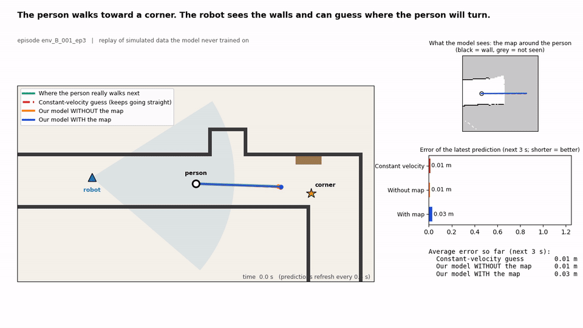
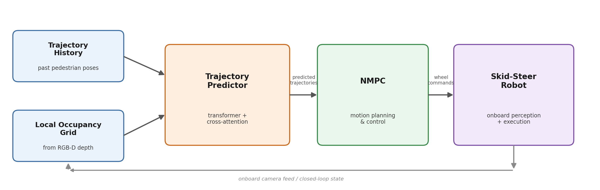
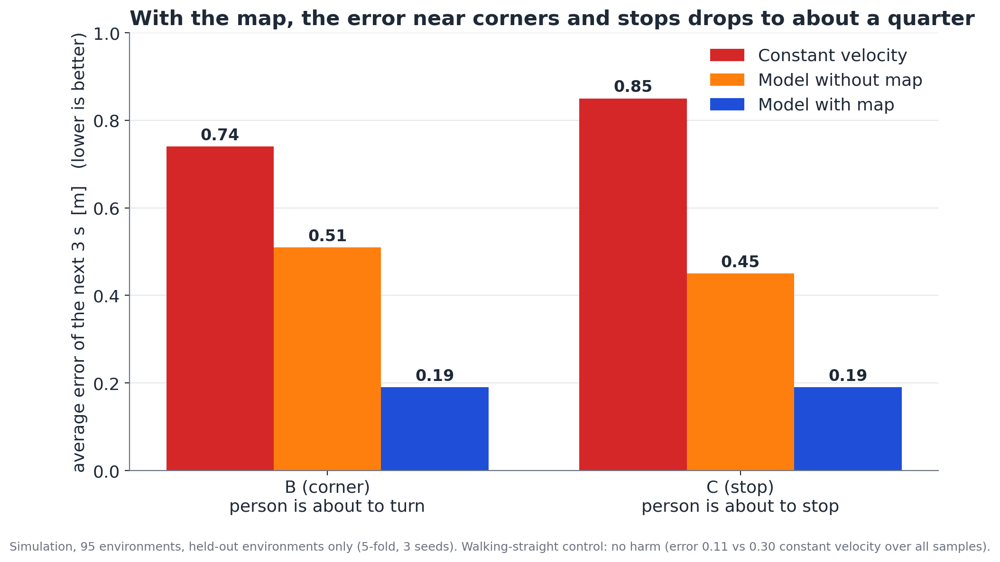
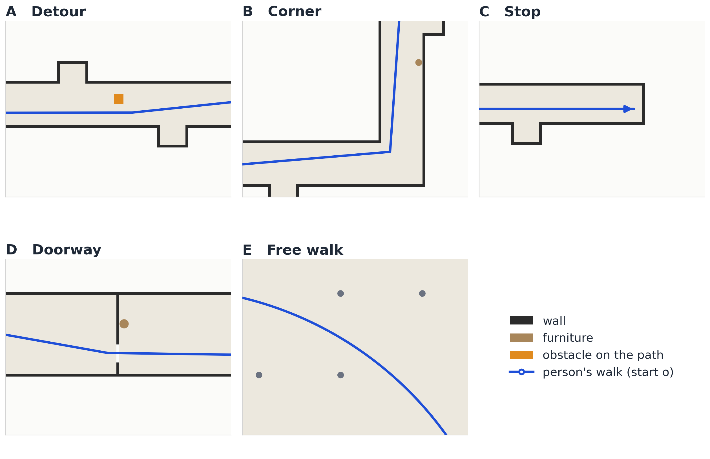
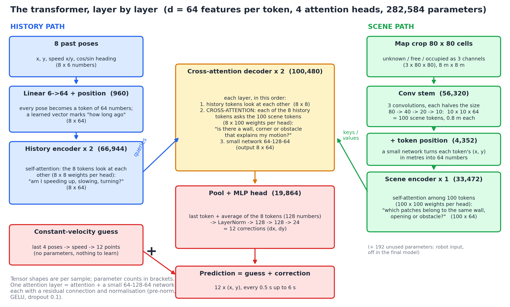
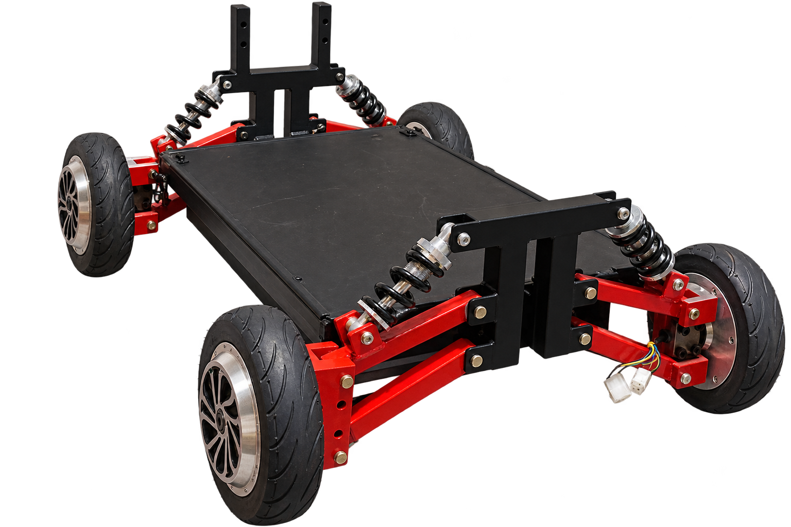

<div align="center">

# Scene-Context-Aware Pedestrian Trajectory Prediction for Mobile Robot Navigation

**A lightweight transformer that predicts where a pedestrian will walk in the next 6 s from their recent motion and the robot's local occupancy map.**

[](https://docs.ros.org/en/humble/)
[](https://gazebosim.org/docs/fortress)
[](https://github.com/robotics-upo/hunav_sim)
[](https://www.python.org/)
[](https://pytorch.org/)
[-2EA44F)](#roadmap)



<sub>Held-out simulated episode. <b>Green</b>: what the person actually does · <b>red dashed</b>: constant-velocity guess · <b>orange</b>: our model without the map · <b>blue</b>: our model with the map.</sub>

</div>

---

## Overview

Robots that share corridors with people need to know where those people will be in the next few seconds. Simple predictors that extrapolate the current velocity fail exactly when it matters: when a person turns at a corner, stops at a dead end, or walks through a door. In most of these situations the cause is **visible in the scene** before it happens.

This repository contains the full pipeline used to test that idea:

1. **Simulation and data collection.** ROS 2 Humble, Gazebo Fortress and HuNavSim pedestrians in procedurally generated environments (5 scenario types, 95 environments), recorded from the robot's point of view.
2. **Robot-centric input.** For every pedestrian, an 8 m × 8 m occupancy crop (free / occupied / unknown) is cut from the robot's map and rotated into the pedestrian's frame, together with the last 3.5 s of motion.
3. **A small transformer (282k parameters)** whose motion tokens cross-attend to 100 scene tokens and correct a constant-velocity guess, predicting 12 positions over 6 s.
4. **A pre-registered evaluation.** Environment-grouped cross-validation, 3 seeds, bootstrap intervals over environments, and hypotheses fixed before every run, including leak checks and counterfactual map edits.

<div align="center">

<br/><sub>Target system. The predictor and its evaluation are complete in simulation; NMPC integration and hardware deployment are in progress (see <a href="#roadmap">Roadmap</a>).</sub>
</div>

## Key results (MVP, simulation)

Average displacement error over the next 3 s, on samples where the turn or stop happens within 4 s (held-out environments, lower is better):

| Predictor | Corner (B) | Stop (C) | All samples |
|---|:---:|:---:|:---:|
| Constant velocity | 0.74 m | 0.85 m | 0.30 m |
| Transformer, **no map** | 0.51 m | 0.45 m | 0.17 m |
| Simple fusion (GRU + CNN), map | 0.20 m | 0.20 m | 0.11 m |
| **Transformer, map (ours)** | **0.19 m** | **0.19 m** | **0.11 m** |

- **The map cuts the error near corners and stops by about 60 %** compared with the same network without it, with no loss on straight-walking controls.
- **It reads the actual scene, not only the scenario type.** Given another environment's map, the corner error rises from 0.19 m to 0.61 m. Deleting the obstacle that explains a stop moves 86 % of predictions toward "keep walking" (36 % for an edit 2.5 m away).
- **Not a robot-placement shortcut.** A control model that only sees the robot's camera cone gains 3.6 %, below the 5 % leak threshold fixed in advance.
- **Robust to tracker noise and fast.** The final model is trained with tracker noise: at 0.1 m of position noise it keeps 0.27 m on corners against 0.84 m for constant velocity. It runs in **2.4 ms per prediction** on a laptop CPU.

<div align="center">

</div>

<details>
<summary><b>Limitations found in the MVP</b> (what the full project addresses)</summary>

- **Map accuracy matters.** A 0.2 m shift or a 10° rotation of the map roughly doubles the corner error, and a wrong map is worse than no map. A real system needs accurate registration and a fallback.
- **Partial transfer.** Trained without a scenario type, the model keeps only a small part of its gain on that type and is not better than constant velocity on doorways. It learned the situations it was trained on, not a general notion of walls.
- **Simulator behaviour.** Pedestrians come from a route planner plus a social-force model, so real people will be less predictable and the real gain smaller.
- **Single pedestrian, single trajectory**, no interaction with the robot or with other people.

Full numbers, intervals and every hypothesis verdict: [`mvp_model/docs/results.md`](mvp_model/docs/results.md).
</details>

## Scenarios

<div align="center">

</div>

**A** detour around an obstacle (control) · **B** turn at a corner · **C** stop explained by the scene · **D** pass through a doorway · **E** free walk (control). Each type is a template whose geometry (hallway width, leg lengths, turn side, alcoves, furniture) and episodes (start, goal, speed, robot placement) are randomized.

## Model

<div align="center">

</div>

| Block | Details | Parameters |
|---|---|---:|
| History encoder | 8 poses → 8 tokens (d = 64), 2 self-attention layers | 67.9k |
| Scene encoder | 80 × 80 crop → conv stem → 10 × 10 = 100 tokens (0.8 m each) + 1 self-attention layer | 94.1k |
| Cross-attention | 2 decoder layers: motion tokens query scene tokens | 100.5k |
| Head | pooled tokens → 12 (dx, dy) corrections added to constant velocity | 19.9k |
| **Total** | | **282.6k** |

Layer-by-layer description and design rationale: [`mvp_model/docs/architecture.md`](mvp_model/docs/architecture.md).

## Repository structure

```
my_robot_description/
├── models/my_robot_description/   Robot URDF/xacro (skid-steer base, depth cameras), meshes
├── launch/                        Simulation launch files (robot, HuNavSim, full stack)
├── worlds/, hunav_assets/         Gazebo worlds, HuNavSim scenarios and behaviour trees
├── hunav_codes/                   Bridges, occupancy-grid builder, pedestrian-crop extraction, time sync
├── agent_control/                 Pedestrian / robot control, obstacle spawning, route planning
├── dataset_codes/                 Recorder and dataset-quality analyses
├── mvp_collection/                Procedural environment generator and unattended episode runner
├── mvp_model/                     Predictor: data loading, models, training, evaluation, figures
│   ├── motion/                    Dataset, models, baselines, damage / counterfactual tools
│   ├── train.py, evaluate.py      Cross-validated training and pre-registered evaluation
│   ├── inspect_model.py           Robustness and counterfactual tests
│   ├── make_video.py, figures/    Demo videos and paper / presentation figures
│   ├── tests/                     Unit and integration tests
│   └── docs/                      Specification, evaluation plan, results, architecture
├── notebooks/                     Exploratory analysis
└── images/                        Figures used in this README
```

## Getting started

**Requirements:** Ubuntu 22.04, ROS 2 Humble, Gazebo Fortress, [HuNavSim](https://github.com/robotics-upo/hunav_sim), Python 3.10. Training additionally needs PyTorch 2.x (a GPU is optional; the MVP was trained on a Kaggle T4).

```bash
# 1. Build
cd ~/ros2_ws/src && git clone https://github.com/Alikheiri01/my-robot-description.git my_robot_description
cd ~/ros2_ws && colcon build --packages-select my_robot_description && source install/setup.bash

# 2. Run the simulation (robot + HuNavSim pedestrians)
ros2 launch my_robot_description my_robot_hunav_full.launch.py

# 3. Generate environments and record a dataset (no GUI, unattended)
cd ~/ros2_ws/src/my_robot_description/mvp_collection
python3 environment_generator.py --all --envs 20 --seed 1 --dataset mvp_v1
bash run_collection.sh datasets/mvp_v1/*

# 4. Train and evaluate (from mvp_model/)
cd ../mvp_model
python3 pack_dataset.py                       # one file for Kaggle / Colab
python3 train.py --variant full_hn            # 3 seeds x 5 environment-grouped folds
python3 train.py --variant hist_hn            # the same network without the map
python3 evaluate.py --help                    # full command in docs/evaluation-plan.md

# 5. Demo videos and figures
python3 make_video.py
python3 figures/make_figures.py --all
```

Step-by-step guides: [`docs/steps.md`](mvp_model/docs/steps.md) · [`docs/kaggle-guide.md`](mvp_model/docs/kaggle-guide.md) · [`docs/evaluation-plan.md`](mvp_model/docs/evaluation-plan.md)

## Roadmap

- [x] Simulation stack: robot model, HuNavSim pedestrians, robot-centric occupancy grid and pedestrian crops
- [x] Procedural environments and unattended data collection (`mvp_v1`, 95 environments)
- [x] Scene-aware transformer, baselines and pre-registered evaluation (MVP)
- [x] Robustness, leak and counterfactual tests; demo videos
- [ ] Larger and more diverse simulated data; evaluation on real-world pedestrian datasets
- [ ] Map-confidence signal and fallback for imperfect maps
- [ ] Integration with NMPC for skid-steer navigation (closed loop in simulation)
- [ ] Deployment on the physical robot (Jetson Orin Nano)

## Platform

<table>
<tr>
<td width="45%"></td>
<td>Skid-steer mobile robot with RGB-D depth cameras, modelled in URDF/xacro from the SolidWorks design and simulated in Gazebo Fortress. On-board computer for deployment: NVIDIA Jetson Orin Nano.</td>
</tr>
</table>

## Citation

This work is part of an MSc thesis in progress. If you use the code, please cite the repository:

```bibtex
@misc{scene_aware_ped_prediction,
  title  = {Scene-Context-Aware Pedestrian Trajectory Prediction for Mobile Robot Navigation},
  author = {AUTHOR NAME},
  year   = {2026},
  howpublished = {\url{https://github.com/Alikheiri01/my-robot-description}}
}
```

## Acknowledgements

Pedestrian simulation by [HuNavSim](https://github.com/robotics-upo/hunav_sim) (Pérez-Higueras et al.). Built on ROS 2 and Gazebo.

## License

BSD-3-Clause. See [LICENSE](LICENSE).
