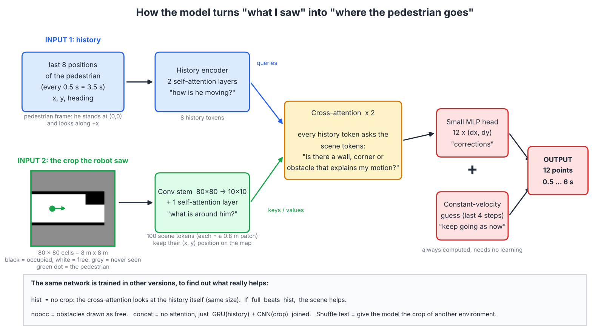

# Model spec (v1, 2026-11-08)

First version, built on the MVP dataset `mvp_v1`. Everything here is a default that can be changed. Whether the idea works is decided by `evaluation-plan.md`, not by this file.

## 1. The task in one paragraph
A robot sees a pedestrian. We know where the pedestrian was during the last 3.5 s (8 positions, one every 0.5 s) and we have the robot's map of the area around him (the "crop"). We want his position for the next 6 s (12 points, one every 0.5 s). The result goes to an MPC controller, so the model must be small, fast, and give ONE trajectory.

The idea we test: the crop contains the reason for some movements (a corner, a wall, an obstacle, a dead end) that the history alone cannot show. A model that sees the crop should predict those movements better than the same model without it.

## 2. The two inputs, exactly
- **History**: 8 poses (x, y, heading) in the pedestrian frame at the last moment ("anchor"). In this frame he always stands at (0, 0) and looks along +x, so the last history row is 0.
- **Crop**: 80 x 80 cells, 0.1 m each. It covers x from -2 m (behind him) to 6 m (ahead), and y from -4 m to 4 m. Cell values: -1 = never seen (unknown), 0 = free, 100 = occupied.

## 3. The picture


The same thing in text:

```
 history (8 x [x,y,heading]) ---> History encoder (2 self-attention layers) ---> 8 history tokens --+
                                                                                                    |  "queries"
                                                                                                    v
 crop (80x80) -> Conv stem (80->10) -> 100 scene tokens + (x,y) position -> 1 self-attention --> Cross-attention x2 --> MLP head --> 12 x (dx,dy)
                                                                          "keys / values"                                              |
 history --> constant-velocity guess (last 4 steps) ---------------------------------------------------------------------------------> ( + ) --> 12 predicted points
```

### What each part does, in plain words
1. **History encoder.** Turns the 8 positions into 8 "tokens" (small vectors) and lets them talk to each other (self-attention). Result: a summary of how he is moving: speed, direction, slowing down, starting to turn.
2. **Conv stem.** Shrinks the 80 x 80 picture to 10 x 10 patches (each patch = 0.8 m x 0.8 m) and describes each patch by a vector. These are the 100 "scene tokens". Each token also gets its own (x, y) position on the map, so the model knows where in front of him a patch is.
3. **Cross-attention.** The history tokens "look at" the scene tokens and pick out the ones that matter for them: "is there a wall ahead? an opening on the left?". This is the one place where scene and motion meet.
4. **Head.** A small network turns the result into 12 corrections (dx, dy).
5. **Constant-velocity guess (CVM).** A fixed, non-learned prediction: "he keeps walking as in the last 2 s". The model's corrections are ADDED to it. So at the start of training the model is exactly CVM, and it only has to learn what CVM gets wrong (turns, stops). If the crop is useless it falls back to about CVM.

### Two output styles
Every version below exists in two styles:
- **residual** (the default described above): the network outputs a CORRECTION that is added to the constant-velocity guess.
- **direct** (name ends in `_direct`, e.g. `full_direct`): the network outputs the 12 positions itself, with no constant-velocity guess added. Its raw output is multiplied by a fixed 3 m only so a normal-sized output can reach paths several metres long; the multiplier is not a motion model.
Why both: residual is the safer start, direct shows whether the network can learn the whole motion alone (and whether the CVM "crutch" hides or helps anything). Residual is the PRIMARY family (decided before results); direct is a secondary comparison.

### Size
About 0.3 million parameters (`tests/test_torch.py` prints the exact numbers).

## 4. The versions we train (same code, one thing changed each)
| name | what changes | question it answers |
|---|---|---|
| `full` | history + crop | the proposed model |
| `hist` | no crop; the cross-attention looks at the history tokens themselves (same depth, same parameter count) | the fair "no scene" reference. `full` beats `hist` = the scene helps |
| `noocc` | occupied cells are shown as free | does it use the obstacles, or only the pattern of known/unknown cells? |
| `concat` | no attention: GRU over the history + small CNN over the crop, vectors joined | is the transformer needed, or does simple fusion do the same? |
| `*_direct` | any of the above with the direct output style | residual vs direct |
| `robot` | adds the robot position as one extra scene token | only if we suspect the robot placement leaks the answer (off by default) |

Two more tests use the trained `full` model without retraining: the crops are swapped for another environment's crop (`shufscn` = same scenario, `shufall` = any scenario). See H4.

## 5. Training (`train.py`)
- Only "usable" samples (pedestrian seen at the anchor and in at least 6 of the 8 history steps).
- 5 folds, split by ENVIRONMENT (never by sample), each scenario spread over all folds. Details in `evaluation-plan.md`.
- Per fold: about 1/8 of the training environments are kept as validation for early stopping. The test fold is never used for any decision.
- Loss = ADE (average distance to the label over the 12 steps). AdamW, learning rate 2e-3 with one-cycle schedule, batch 128, up to 60 epochs, stop after 10 epochs without improvement.
- Augmentation (training only): mirror left/right (y -> -y for history, label and crop rows). This is needed because e.g. in scenario E 80 % of the bends go left.
- 3 seeds per version.

## 6. Choices we made and why
- **Correction over CVM**: straight walking is already solved by CVM; the network spends its effort on what CVM gets wrong.
- **Cross-attention**: smallest design in which "the motion asks the scene" is explicit and can be looked at later (attention maps) for the thesis.
- **Conv stem, 100 tokens**: 6400 pixel tokens would be slow and overfit.
- **Scene token position from (x, y)** with a small MLP, instead of a learned table of 100 positions: with only ~95 environments a free table overfits, and the (x, y) version also behaves sensibly under the left/right mirror.
- **One trajectory**: the MPC takes one path. Several possible paths (multimodal) can come later.
- **No robot position as input**: in the MVP the robot is placed by a script, so it could leak information.

## 7. Not in this version
Multimodal output, several pedestrians interacting, hyper-parameter search (with ~95 environments a search would overfit the folds), other scene formats (SDF etc.).

## 8. Size and speed targets (proposal, to confirm against the MPC rate)
At most 1 M parameters and at most 5 ms per prediction on the Jetson Orin Nano after export (measured in step H9).
